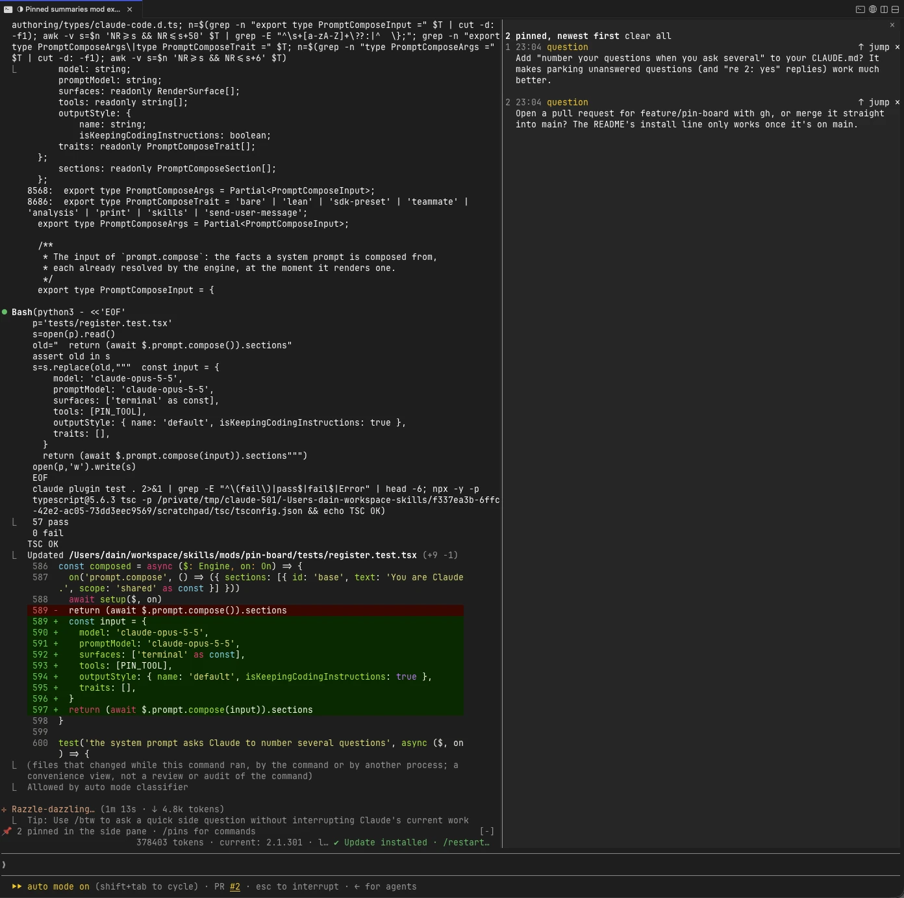

# pin-board

A Claude Code mod that keeps what matters from **background-woken turns** pinned above the prompt.

When Claude is watching a PR, running a Monitor, waiting on subagents or looping with `/loop` / ScheduleWakeup, each wake-up ends with a summary or a question. The transcript scrolls past it and it's easy to miss. pin-board catches those and pins them (in a side pane in fullscreen, above the prompt otherwise) until you dismiss them.



On the normal screen, pins show in a band above the prompt instead:

```
📌 Pinned (2) clear all
▸1 10:05 summary   CI is green on all three branches; two reviewers approved…  ↑ jump ✕
▸2 09:41 question  PR #42 got a review: rename the helper or keep it?          ↑ jump ✕
```

## How it decides what to pin

It works in two layers:

1. **Automatic (safety net).** When a turn was started by something other than you (a task notification, a scheduled trigger, another session, a channel, another plugin), its final answer is pinned if it:
   - asks a question: a line ending in `?`, outside code fences; or
   - is at least 280 characters, so it reads as a summary rather than an all-clear.

   Short "nothing new, still watching" answers are skipped. Turns you started yourself are never auto-pinned.
2. **Claude-driven (curated).** Claude gets a `pin` tool (`mcp__pin-board__pin`), approved without a permission prompt unless you deny it. Its description is one sentence, so it costs little on every request. The guidance on *when* to pin during wake-ups is attached only to prompts that come from background events, which is where it matters. When Claude pins during such a turn, the automatic pin for that turn is skipped.

## Parking unanswered questions

When Claude asks several things and you answer only some, or reply about something else, Claude can pin what's still open, instead of reminding you every turn:

```
pin({ kind: "question",
      text: "Still open: Q2 (rename the helper?) and Q4 (keep the v1 endpoint?)",
      quote: "Should we keep the v1 endpoint" })
```

| Field | Meaning |
|---|---|
| `text` | What you need to see, in a line or two |
| `kind` | `question`, `decision` or `fyi` (the default) |
| `quote` | Optional. A short exact excerpt of Claude's earlier message the pin is about |
| `replaces` | Optional. The id of Claude's earlier pin to update, or, with empty `text`, remove |

So that you can answer by number and Claude can see which questions are left, the mod adds one line to Claude's system prompt: when it asks several questions in one message, number them, and pin any left unanswered. The line is cached with the rest of the system prompt, so it costs almost nothing per turn. To turn it off, set **Number Claude's questions** (`numberQuestions`) to off in the config menu.

Each of Claude's pins gets a stable id (`p1`, `p2`, …). The tool's reply tells Claude the id and how to update or remove that pin, so when you answer Q2, Claude can change the pin to "Still open: Q4", or remove it once nothing is left. Updating a pin you already dismissed creates a new one.

## Where pins show

- **Fullscreen:** a new pin opens a **Pins** pane docked beside the transcript, running from the top of the screen to the bottom, with every pin in full, newest first. The band above the prompt shrinks to one line. If you close the pane, it stays closed until you run `/pins`. The mod opens the pane itself only on a terminal at least 144 columns wide; `/pins` opens it at any width.
- **Elsewhere:** pins show in the band above the prompt, newest first, one line each. ▸ expands a pin to its full text, rendered as Markdown.

Pins never disappear on their own. See [Resuming a session](#resuming-a-session) for what happens to them across sessions.

## Keyboard and mouse

Pins are numbered newest first, and `/pins` runs at once, even while Claude is working:

| Command | Does |
|---|---|
| `/pins` | Lists the pins, and reopens the side pane in fullscreen |
| `/pins <n>` | Shows pin *n* in full |
| `/pins go <n>` | Scrolls the transcript to where pin *n* came from |
| `/pins done <n>…` | Dismisses pins by number, e.g. `/pins done 1 3` |
| `/pins clear` | Dismisses every pin |

The buttons are also reachable from the keyboard: press `ctrl+x tab` to put focus on the band or pane, then Tab between buttons, Enter to press one, and Esc to go back to the prompt.

With the mouse, every button (▸, ↑ jump, ✕, clear all) is clickable in the fullscreen terminal, the desktop app and VS Code; the wheel scrolls the band and pane. On the terminal's normal screen Claude Code doesn't receive clicks, so use the keys or `/pins` there.

## Jumping back to the transcript

**↑ jump** (or `/pins go <n>`) scrolls the transcript to where the pin came from:

- **a pin with a matching `quote`:** the earlier reply it quotes, shown from its top. The match ignores case, spacing and markdown emphasis, and checks the last 200 replies, newest first.
- **a pin from Claude without a quote, or whose quote didn't match:** the `pin` call itself, placed at the **bottom** of the screen, so the questions and your answer that led to it show above it. Claude is told when its quote didn't match.
- **an automatic pin:** the turn's last text reply, shown from its top.

The reply index is rebuilt from the session's transcript when you resume it, and after a hot reload of the mod.

It only works in fullscreen, where Claude Code scrolls the transcript itself; on the normal screen your terminal owns the scrollback. Claude Code only moves the transcript when you ask, by a press or a typed command. If it can't move there (for example, the row is folded into a collapsed tool group), a toast says why.

## Resuming a session

The board is saved in the mod's store under the session's id after every change, so `claude --resume` (or `/resume`) brings back that session's pins, and Claude's pin ids carry on from where they were.

- **`/clear`** and **`--fork-session`** start with an empty board. The board you left stays saved under the old session, ready for its resume.
- **The reply index** isn't saved; it's rebuilt from the whole transcript, whatever its size, by streaming `grep` for Claude's reply lines (the replies are a small part of a transcript, under 15% here). Where `grep` isn't available, as on Windows, a transcript up to 4 MiB is read whole instead; beyond that, quotes only match replies written since, and jumps fall back to the pin call.
- The transcript's format belongs to Claude Code, not the mods API, so the mod skips any line it doesn't recognise rather than failing.
- Boards of the 50 most recent sessions are kept; older ones are pruned.
- Installed or enabled partway through a session, the mod finds the session and its transcript at your next prompt.

### Where an organization manages Claude Code

There, a mod you install yourself doesn't receive Claude Code's session events or system-prompt composition; only mods the organization lists in managed settings do. Pinning, the band, the pane, jumps and `/pins` all still work, but:

- pins aren't restored on resume, and `/clear` doesn't empty the board;
- the reply index only covers replies written since the mod loaded;
- the question-numbering line isn't added (put it in your CLAUDE.md instead).

## Install

At the prompt of a terminal session:

```
/plugin install pin-board --marketplace daaain/skills
```

To try it from a clone without installing:

```bash
claude --plugin-dir ./mods/pin-board
```

## Develop

```bash
claude plugin validate mods/pin-board   # what it hooks and calls
claude plugin test mods/pin-board       # unit + integration tests
```

- `hooks/pins.ts` holds the pure logic: origin classification, the question and summary heuristics, previews, quote matching, transcript parsing, board pruning, and `/pins` argument parsing.
- `hooks/register.tsx` holds the hooks: turn tracking, the reply index, saving and restoring the board per session, the `pin` tool (`quote`, `replaces`) and its wake-only guidance, `/pins`, the `AbovePrompt` band and the `Pins` pane.
- `types/index.d.ts` is the `$.state` contract.
